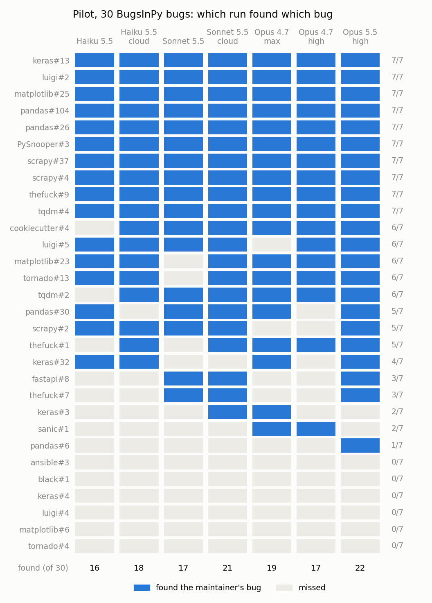
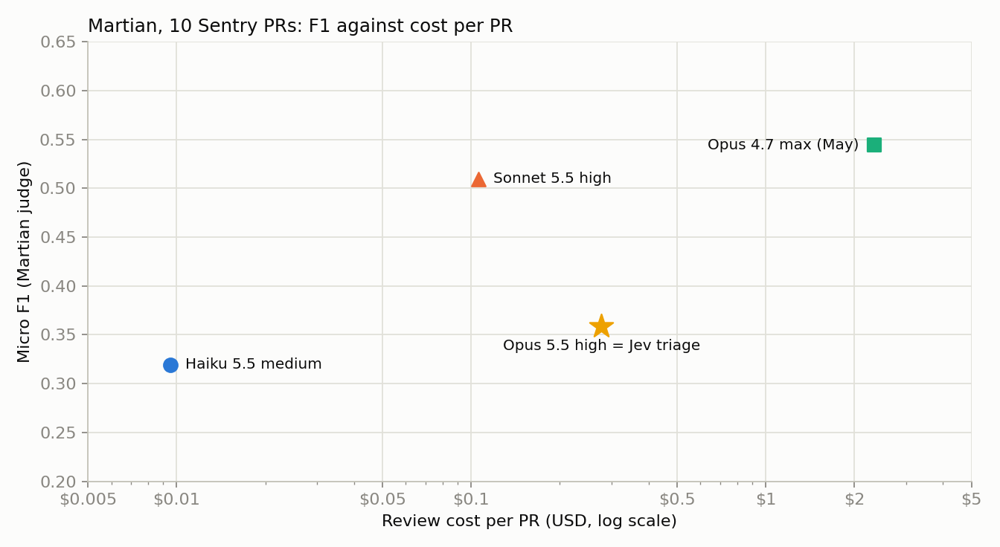

# Model tiers and Jev triage: experiment log

What was run, in what order, and what each step found. Newest step last.
Detailed tables live in [`PILOT_REPORT.md`](PILOT_REPORT.md); this log is the narrative
and the index. Figures are drawn from committed results by
`bugsinpy_bench/scripts/make_figures.py`.

**Question.** Can a router (Jev) send easy reviews to cheaper models without losing
bugs, and how does that compare with simply reviewing everything with one model?

**Branch.** `bench/model-tiers-pilot-local` on `Hendrik040/code-review-agent`, a
feature branch off `bench/bugsinpy`. Not merged into `main`.

## Fixed setup for every step

| Setting | Value |
|---|---|
| Benchmark | BugsInPy, 100 bugs (`dataset/prepared_100.json`), reviewer sees the bug-introducing commit |
| Reviewer | Agent SDK reviewer (`agent_sdk/reviewer.py`), same prompts, tools and `MAX_TURNS` (100) as May |
| Judge | `claude-sonnet-4-5-20250929`, `judge.py` and `score.py` unchanged; "found" = target recall (finding matches the maintainer's fix) |
| Line tolerance / bug timeout | 10 lines / 1800 s |
| Sandbox | Local temporary checkout (`SANDBOX_BACKEND` unset). May ran on Daytona |
| CLI config | `CLAUDE_CONFIG_DIR` set to an empty folder, so the CLI does not load the machine owner's plugins and skills (see step 2) |
| Billing | API key from `.env`; every trace records `use_oauth: False` |
| Cost | Harness-reported `total_cost_usd`, checked against list prices recomputed from token usage |

## Timeline

| # | When (UTC) | Step | Result in one line |
|---|---|---|---|
| 0 | 2026-05-03/04 | May baseline: Opus 4.7 at low, high, max on all 100 bugs (and Martian) | Stored on `bench/bugsinpy` |
| 1 | 2026-11-26 22:00 | Pushed the May bench data and traces to `bench/bugsinpy` | Made the baseline reproducible |
| 2 | 2026-11-26 23:29 | Smoke tests, Haiku 5.5 and Sonnet 5.5 on PySnooper#3 | Personal CLI setup added ~90K tokens per request; isolated it |
| 3 | 2026-11-26 23:31-23:51 | Pilot: Sonnet 5.5 high and Haiku 5.5 medium on 30 bugs | 17/30 and 16/30 for $1.51 and $0.14 |
| 3b | 2026-11-26 23:25-23:47 | A second run of the same plan (cloud) pushed `bench/model-tiers-pilot` | 21/30 and 18/30: run-to-run noise of ±2-4 bugs |
| 4 | 2026-11-27 00:10 | Jev routing of the 30 bugs, two passes; triage scored from stored results | 6-8 to Sonnet, rest to Opus; 13-25% cheaper than all-Opus 4.7 |
| 5 | 2026-11-27 00:13-00:40 | Opus 5.5 high on the 30 bugs (needed a newer CLI) | 22/30 for $4.77 |
| 6 | 2026-11-27 00:45-01:40 | Full benchmark: all three models on the other 70 BugsInPy bugs and Martian's 10 PRs, six sweeps in parallel | Triage matches all-Opus 5.5 (42/100) for 13% less |
| 7 | 2026-11-27 | Trace analysis of Opus 5.5's misses; alternative routings scored from stored results | Opus 5.5 often sees the bug and decides not to report it; triage + Haiku second pass: 48/100 for $14.66 |

## Step 0. May baseline (Opus 4.7)

Opus 4.7 reviewed all 100 bugs at three effort levels on 2026-05-04: 17, 28 and 30
found, for $24.29, $54.35 and $112.40 (Agent SDK). Those sweeps are the "no triage"
baseline. On the 30 pilot bugs they found 10, 17 and 19.

## Step 1. Publish the baseline

The May benchmark data and traces were pushed to `bench/bugsinpy` (commits `05f42c1`,
`4ed7648`, `8ec32c2`) so later runs could branch from it and reuse the stored results.

## Step 2. Smoke tests and the CLI-config finding

One bug (PySnooper#3) per model. Both models found it. But the first request of each
review was 124,574 tokens, against 47,635 for the same bug in May: the Agent SDK's
CLI was loading the machine owner's own Claude Code plugins, skills and MCP servers.
With `CLAUDE_CONFIG_DIR` pointed at an empty folder the first request fell to about
35,000 tokens and the cost of the Haiku run from $0.023 to $0.009. Every later run
uses the isolated setup.

## Step 3. Pilot: Haiku 5.5 and Sonnet 5.5 on 30 bugs

The 30 bugs come from `prepared_100.json` in three groups of 10, picked by the May
Opus 4.7 results: found at low effort, found only at high or max, never found. That
choice makes the Opus 4.7 columns fixed by construction, so recall comparisons lean
toward Opus 4.7.

| Run | Found (of 30) | Cost |
|---|---:|---:|
| Haiku 5.5 medium | 16 | $0.14 |
| Sonnet 5.5 high | 17 | $1.51 |
| Opus 4.7 low / high / max (May) | 10 / 17 / 19 | $6.25 / $16.37 / $30.67 |

**Step 3b.** A second run of the same plan, started from the cloud, pushed its results
to `bench/model-tiers-pilot` during these sweeps. Ours went to
`bench/model-tiers-pilot-local` instead. Its Sonnet found 21/30 and its Haiku 18/30.
Each model's two runs disagree on 4 of 30 bugs, which sets the noise floor for every
comparison in this log.

## Step 4. Jev triage, scored without new reviews

Every bug now had a result for every tier, so routing could be scored by looking up
the routed tier's result. Jev (router code from `claude/jev-model-routing` at
`3e69e01`) sends a diff to the cheapest tier whose chance of needing a deeper review
is at most 0.15; high-stakes code always goes deep.

- **Routes:** no bug went to Haiku. 6 went to Sonnet and 24 to Opus on the committed
  pass; a first pass sent 8 to Sonnet. Two bugs sat at 0.13-0.17 against the 0.15
  threshold and changed tier between passes.
- **Result:** with Opus 4.7 max as the deep tier, triage found 20-21/30 for $24.61,
  against 19/30 for $30.67 without triage. With Opus 4.7 high: 19-20/30 for $14.50,
  against 17/30 for $16.37.

## Step 5. Opus 5.5 high as the senior reviewer

The Agent SDK's bundled CLI (2.1.126) is too old for Opus 5.5 (needs 2.1.280+).
`agent_sdk/reviewer.py` gained an opt-in `REVIEW_CLI_PATH`; this run used Claude
Code 2.1.332. A Sonnet 5.5 check on the newer CLI matched the bundled one within
2.5% on prompt size and cost.

| Setup | Found (of 30) | Cost |
|---|---:|---:|
| All Opus 5.5 high (no triage) | 22 | $4.77 |
| Jev triage, deep = Opus 5.5 high | 21-22 | $4.14 |
| All Opus 4.7 max (no triage, May) | 19 | $30.67 |

The model upgrade does most of the work: more bugs at about a sixth of the cost.
With Opus 5.5 as the deep tier, triage saves only 13%, because Jev still sends 24
of 30 bugs to it.

### Do the models find the same bugs?

Mostly. 10 bugs were found by all seven runs and 6 by none. Opus 5.5 and Opus 4.7
(high or max) share 18 found bugs; Opus 5.5 adds fastapi#8, pandas#6, scrapy#2 and
thefuck#7, and misses keras#3 and sanic#1. Only pandas#6 (Opus 5.5) and sanic#1
(Opus 4.7) were found by a single model.

## Step 6. Full benchmark: every model on every bug

**What ran.** Jev routed the 70 BugsInPy bugs outside the pilot
(`dataset/prepared_rest70.json`; routes in `routing/routes_rest70.json`) and Martian's
10 Sentry PRs (`martian_bench/routing/routes_martian.json`). Then Haiku 5.5 medium,
Sonnet 5.5 high and Opus 5.5 high each reviewed all 70 bugs and all 10 PRs, so
every model has a result for every bug: together with the pilot, each single-model
arm covers the full 100 BugsInPy bugs. Triage is scored from those results, as in
step 4. Scores: `bugsinpy_bench/scripts/score_full.py`, output
`routing/full_scores.json`.

**Running sweeps in parallel.** The reviewer used to number each run as the highest
existing trace number plus one, so two sweeps at once could take the same number and
overwrite each other's trace. `_next_run_id` in `agent_sdk/reviewer.py` now reserves
its number by creating the trace file exclusively and moving on if it already exists
(64 parallel reservations gave 64 unique numbers). The six sweeps then ran at once in
41 minutes. A sequential queue had been started first and was stopped after two
Opus 5.5 bugs; those runs (about $0.30) were deleted and redone.

**Routing.** BugsInPy, all 100 bugs: 2 light, 26 standard, 72 deep. Martian: all 10
deep (8 by Jev's answer, 5 of them high-stakes; for 2 PRs Jev returned
`TypeSafeBadRequestError` and the router fell back to deep), so triage on Martian is
the same as all-Opus 5.5.

**One Martian PR needed a rerun.** On `sentry-greptile#1` the Sonnet and Haiku runs
failed with the Agent SDK's 1 MB message-buffer limit on the bundled CLI. Opus 5.5,
on Claude Code 2.1.332, was not affected. That PR was rerun for Sonnet and Haiku on
2.1.332 in `_tail` sweeps, whose verdict and cost replace the failed row.

### BugsInPy, all 100 bugs

| Setup | Found (of 100) | Cost | Per bug |
|---|---:|---:|---:|
| All Haiku 5.5 medium | 35 | $0.52 | $0.005 |
| All Sonnet 5.5 high | 35 | $5.60 | $0.056 |
| All Opus 5.5 high | 42 | $16.33 | $0.163 |
| **Jev triage** (light Haiku, standard Sonnet, deep Opus 5.5) | **42** | **$14.15** | **$0.142** |
| All Opus 4.7 low / high / max (May) | 17 / 28 / 30 | $24.29 / $54.35 / $112.40 | $0.24 / $0.54 / $1.12 |

On the 26 bugs routed to Sonnet, Sonnet and Opus 5.5 each found 10, for $1.17 against
$3.21. Neither model found the 2 bugs routed to Haiku. Opus 5.5 found 11 bugs that no
Opus 4.7 run found and missed 3 that one did (keras#3, pandas#121, sanic#1).

**Different models find partly different bugs.** Together, the three 2026-11 models
found 49 distinct bugs, against 42 for Opus 5.5 alone. Haiku found 6 bugs neither
Sonnet nor Opus 5.5 found; Opus 5.5 found 4 bugs neither cheaper model found.

### Martian, 10 Sentry PRs

Judged with Martian's own judge prompt and the same judge model as May
(`judge_martian.py`); micro scores over 31 golden comments.

| Setup | Recall | Precision | F1 | Cost |
|---|---:|---:|---:|---:|
| All Haiku 5.5 medium | 0.226 | 0.545 | 0.319 | $0.10 |
| All Sonnet 5.5 high | 0.419 | 0.650 | 0.510 | $1.06 |
| All Opus 5.5 high (= Jev triage) | 0.290 | 0.471 | 0.359 | $2.77 |
| Opus 4.7 max (May) | 0.452 | 0.684 | 0.544 | $23.33 |

On Martian, Opus 5.5 high scores below Sonnet 5.5 and below May's Opus 4.7 max. With
10 PRs and a single run per arm this is a small sample; the pilot showed run-to-run
differences of the same size.

## Step 7. Why Opus 5.5 misses, and where triage can improve

No new reviews: this step reads the stored traces (`agent_sdk/traces/run_NNN.txt`),
the judge verdicts, and `full_scores.json`.

### Martian: Opus 5.5 sees bugs and decides not to report them

Opus 5.5 matched 9 of 31 goldens, Sonnet 5.5 matched 13. In four PRs, Opus 5.5's
own closing summary names a golden issue and then gives a reason for leaving it out:

| PR | Golden it described | Its reason for not filing (trace) |
|---|---|---|
| sentry-greptile#2 | Negative queryset slicing (Critical; a High variant too) | "It was already a 500 before this change" (run 511) |
| sentry#80528 | Function returns the original `monitor.config`, not the modified copy (High) | "This PR didn't introduce it" (moved code) (run 602) |
| sentry#93824 | `join()` stops at the deadline without terminating the remaining flushers | Judged the early exit to change nothing in practice (run 580) |
| sentry-greptile#5 | `zip(error_ids, events.values())` pairs IDs with the wrong events | "Left out as low impact" (run 566) |

Filing these would add 4-5 goldens, putting Opus 5.5 at about 13-14 of 31, level
with Sonnet. This is an estimate from the traces, not a rescore. The reviewer prompt's
rule against feedback on code the change didn't break supports some of these
omissions, and Opus 5.5 applies it more strictly than Sonnet. Opus 5.5 also files
fewer findings (17 against Sonnet's 20), often one per PR.

Of the remaining misses, two goldens were never examined (the static OAuth `state`
in sentry#67876, the wrong dataset in greptile#3); most others are test-name typos,
docstrings and magic numbers that no model found. Some false positives look like gaps
in the golden set: the "member is None" finding is a match on greptile#1 but a false
positive on greptile#2, which has near-identical code, and Sonnet independently
filed the same queue-pool finding that scored as a false positive for Opus on
sentry#95633.

### BugsInPy: what triage missed

`scripts/combo_scores.py` lists triage's misses that another model found: 7 bugs.
Six were routed deep and found only by Haiku (luigi#10, luigi#33, pandas#121,
pandas#132, pandas#95, scrapy#31); one was routed standard and found only by
Opus 5.5 (thefuck#1).

The traces show the same habit as on Martian:

- **luigi#10 (run 558):** notes the fast path "can now return tasks that belong to
  other workers" and reasons it is safe. That is the bug.
- **luigi#33 (run 572):** notes positional arguments now bind to different parameters
  and calls it "intended, not a bug". That is the bug.
- **pandas#95 (run 645):** finds the NumPy-integer comparison change and leaves it
  out, partly because "as I recall, released pandas has the same code".
- **pandas#132 (run 674):** states timedelta `std` still works, without running it
  (pandas was not built in the sandbox).
- **pandas#121, scrapy#31:** finds other real bugs, not the target.

The deep tier holds 72 bugs. Opus 5.5 found 32 of them for $12.98; Haiku found 29 for
$0.41 and Sonnet 25 for $4.38. Only 3 (black#12, pandas#6, tornado#12) were found
by Opus 5.5 alone; 34 were found by no model.

### Alternative setups, scored from stored results

| Setup | Found | Cost |
|---|---:|---:|
| Jev triage (as run) | 42/100 | $14.15 |
| Jev triage + Haiku second pass on every bug | 48/100 | $14.66 |
| Haiku everywhere + Opus 5.5 on deep only | 44/100 | $13.49 |
| Haiku on light+standard, Opus 5.5 on deep | 38/100 | $13.08 |
| Haiku + Opus 5.5 on every bug | 49/100 | $16.85 |
| All three on every bug | 49/100 | $22.44 |

Haiku plus Opus 5.5 already cover all 49 bugs any model found. Merging two models'
findings adds false positives, which BugsInPy's target recall does not count; these
are single runs, with run-to-run noise of about ±2-4 bugs on 30.

### Next experiments this suggests

1. Change the reviewer prompt so issues it would otherwise drop are filed (as
   low-severity findings or a separate "considered" list), then rerun Opus 5.5 on
   Martian (about $3) and score both recall and precision.
2. Run Haiku as a second pass next to triage and measure the extra false positives
   on Martian, where precision counts.

## Spend

| Step | Cost |
|---|---:|
| 2-3 Smoke tests, pilot sweeps, judging, router summaries | $2.51 |
| 5 Opus 5.5 smoke tests, sweep, judging | $5.44 |
| 6 Six full sweeps ($19.75), Martian tail reruns ($0.19), judging ($1.14) | $21.08 |
| 6 Stopped sequential start (two Opus 5.5 bugs, cost not recorded) | about $0.30 |
| 7 Trace analysis (no API calls) | $0 |
| **Total** | **about $29.33** |

Jev's own cost is not measured.

## Caveats that apply throughout

- The 30 pilot bugs were chosen by Opus 4.7's May results, so recall against
  Opus 4.7 on this subset is biased in its favour.
- Run-to-run noise is about ±2-4 bugs on 30. Differences smaller than that are noise.
- May's Opus 4.7 runs had larger prompts (about 47.6K tokens on the first request,
  against about 35K now), which inflates their cost somewhat.
- Jev's routing can change between passes for bugs near the 0.15 threshold.
