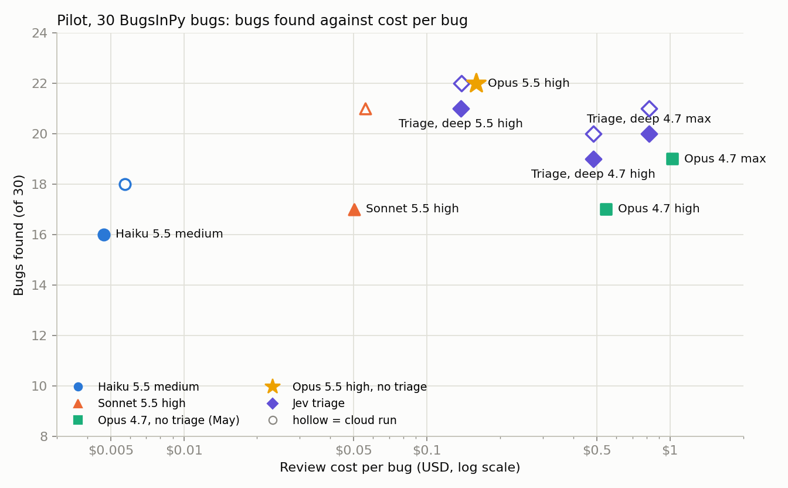

# Model tiers and Jev triage: experiment log

What was run, in what order, and what each step found. Newest step last.
Detailed tables live in [`PILOT_REPORT.md`](PILOT_REPORT.md); this log is the narrative
and the index. Figures are drawn from committed results by
`bugsinpy_bench/scripts/make_figures.py`.

**Question.** Can a router (Jev) send easy reviews to cheaper models without losing
bugs, and how does that compare with simply reviewing everything with one model?

**Branch.** `bench/model-tiers-pilot-local` on `Hendrik040/code-review-agent`, a
feature branch off `bench/bugsinpy`. Not merged into `main`.

## Fixed setup for every step

| Setting | Value |
|---|---|
| Benchmark | BugsInPy, 100 bugs (`dataset/prepared_100.json`), reviewer sees the bug-introducing commit |
| Reviewer | Agent SDK reviewer (`agent_sdk/reviewer.py`), same prompts, tools and `MAX_TURNS` (100) as May |
| Judge | `claude-sonnet-4-5-20250929`, `judge.py` and `score.py` unchanged; "found" = target recall (finding matches the maintainer's fix) |
| Line tolerance / bug timeout | 10 lines / 1800 s |
| Sandbox | Local temporary checkout (`SANDBOX_BACKEND` unset). May ran on Daytona |
| CLI config | `CLAUDE_CONFIG_DIR` set to an empty folder, so the CLI does not load the machine owner's plugins and skills (see step 2) |
| Billing | API key from `.env`; every trace records `use_oauth: False` |
| Cost | Harness-reported `total_cost_usd`, checked against list prices recomputed from token usage |

## Timeline

| # | When (UTC) | Step | Result in one line |
|---|---|---|---|
| 0 | 2026-05-03/04 | May baseline: Opus 4.7 at low, high, max on all 100 bugs (and Martian) | Stored on `bench/bugsinpy` |
| 1 | 2026-11-26 22:00 | Pushed the May bench data and traces to `bench/bugsinpy` | Made the baseline reproducible |
| 2 | 2026-11-26 23:29 | Smoke tests, Haiku 5.5 and Sonnet 5.5 on PySnooper#3 | Personal CLI setup added ~90K tokens per request; isolated it |
| 3 | 2026-11-26 23:31-23:51 | Pilot: Sonnet 5.5 high and Haiku 5.5 medium on 30 bugs | 17/30 and 16/30 for $1.51 and $0.14 |
| 3b | 2026-11-26 23:25-23:47 | A second run of the same plan (cloud) pushed `bench/model-tiers-pilot` | 21/30 and 18/30: run-to-run noise of ±2-4 bugs |
| 4 | 2026-11-27 00:10 | Jev routing of the 30 bugs, two passes; triage scored from stored results | 6-8 to Sonnet, rest to Opus; 13-25% cheaper than all-Opus 4.7 |
| 5 | 2026-11-27 00:13-00:40 | Opus 5.5 high on the 30 bugs (needed a newer CLI) | 22/30 for $4.77 |
| 6 | 2026-11-27 | Full benchmark: remaining 70 BugsInPy bugs and Martian's 10 PRs | In progress |

## Step 0. May baseline (Opus 4.7)

Opus 4.7 reviewed all 100 bugs at three effort levels on 2026-05-04: 17, 28 and 30
found, for $24.29, $54.35 and $112.40 (Agent SDK). Those sweeps are the "no triage"
baseline. On the 30 pilot bugs they found 10, 17 and 19.

## Step 1. Publish the baseline

The May benchmark data and traces were pushed to `bench/bugsinpy` (commits `05f42c1`,
`4ed7648`, `8ec32c2`) so later runs could branch from it and reuse the stored results.

## Step 2. Smoke tests and the CLI-config finding

One bug (PySnooper#3) per model. Both models found it. But the first request of each
review was 124,574 tokens, against 47,635 for the same bug in May: the Agent SDK's
CLI was loading the machine owner's own Claude Code plugins, skills and MCP servers.
With `CLAUDE_CONFIG_DIR` pointed at an empty folder the first request fell to about
35,000 tokens and the cost of the Haiku run from $0.023 to $0.009. Every later run
uses the isolated setup.

## Step 3. Pilot: Haiku 5.5 and Sonnet 5.5 on 30 bugs

The 30 bugs come from `prepared_100.json` in three groups of 10, picked by the May
Opus 4.7 results: found at low effort, found only at high or max, never found. That
choice makes the Opus 4.7 columns fixed by construction, so recall comparisons lean
toward Opus 4.7.

| Run | Found (of 30) | Cost |
|---|---:|---:|
| Haiku 5.5 medium | 16 | $0.14 |
| Sonnet 5.5 high | 17 | $1.51 |
| Opus 4.7 low / high / max (May) | 10 / 17 / 19 | $6.25 / $16.37 / $30.67 |

**Step 3b.** A second run of the same plan, started from the cloud, pushed its results
to `bench/model-tiers-pilot` during these sweeps. Ours went to
`bench/model-tiers-pilot-local` instead. Its Sonnet found 21/30 and its Haiku 18/30.
Each model's two runs disagree on 4 of 30 bugs, which sets the noise floor for every
comparison in this log.

## Step 4. Jev triage, scored without new reviews

Every bug now had a result for every tier, so routing could be scored by looking up
the routed tier's result. Jev (router code from `claude/jev-model-routing` at
`3e69e01`) sends a diff to the cheapest tier whose chance of needing a deeper review
is at most 0.15; high-stakes code always goes deep.

- **Routes:** no bug went to Haiku. 6 went to Sonnet and 24 to Opus on the committed
  pass; a first pass sent 8 to Sonnet. Two bugs sat at 0.13-0.17 against the 0.15
  threshold and changed tier between passes.
- **Result:** with Opus 4.7 max as the deep tier, triage found 20-21/30 for $24.61,
  against 19/30 for $30.67 without triage. With Opus 4.7 high: 19-20/30 for $14.50,
  against 17/30 for $16.37.

## Step 5. Opus 5.5 high as the senior reviewer

The Agent SDK's bundled CLI (2.1.126) is too old for Opus 5.5 (needs 2.1.280+).
`agent_sdk/reviewer.py` gained an opt-in `REVIEW_CLI_PATH`; this run used Claude
Code 2.1.332. A Sonnet 5.5 check on the newer CLI matched the bundled one within
2.5% on prompt size and cost.

| Setup | Found (of 30) | Cost |
|---|---:|---:|
| All Opus 5.5 high (no triage) | 22 | $4.77 |
| Jev triage, deep = Opus 5.5 high | 21-22 | $4.14 |
| All Opus 4.7 max (no triage, May) | 19 | $30.67 |

The model upgrade does most of the work: more bugs at about a sixth of the cost.
With Opus 5.5 as the deep tier, triage saves only 13%, because Jev still sends 24
of 30 bugs to it.

### Do the models find the same bugs?

Mostly. 10 bugs were found by all seven runs and 6 by none. Opus 5.5 and Opus 4.7
(high or max) share 18 found bugs; Opus 5.5 adds fastapi#8, pandas#6, scrapy#2 and
thefuck#7, and misses keras#3 and sanic#1. Only pandas#6 (Opus 5.5) and sanic#1
(Opus 4.7) were found by a single model.

## Step 6. Full benchmark (in progress)

The 70 BugsInPy bugs outside the pilot (`dataset/prepared_rest70.json`) and Martian's
10 Sentry PRs are being routed by Jev. Then Opus 5.5 high reviews all of them (deep
tier and no-triage baseline in one), and Sonnet 5.5 and Haiku 5.5 review only the
bugs routed to them. Results will be added here.

## Spend

| Step | Cost |
|---|---:|
| 2-3 Smoke tests, pilot sweeps, judging, router summaries | $2.51 |
| 5 Opus 5.5 smoke tests, sweep, judging | $5.44 |
| **Total so far** | **$7.95** |

Jev's own cost is not measured.

## Caveats that apply throughout

- The 30 pilot bugs were chosen by Opus 4.7's May results, so recall against
  Opus 4.7 on this subset is biased in its favour.
- Run-to-run noise is about ±2-4 bugs on 30. Differences smaller than that are noise.
- May's Opus 4.7 runs had larger prompts (about 47.6K tokens on the first request,
  against about 35K now), which inflates their cost somewhat.
- Jev's routing can change between passes for bugs near the 0.15 threshold.
