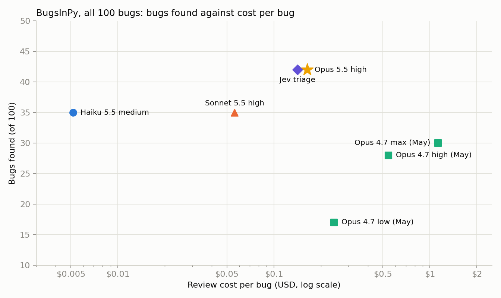
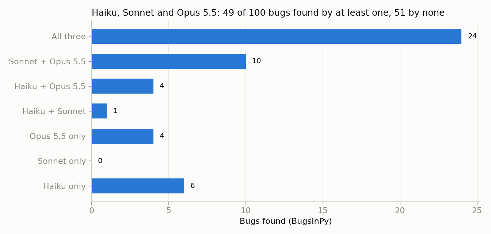

# Model tiers and Jev triage: experiment log

What was run, in what order, and what each step found. Newest step last.
Detailed tables live in [`PILOT_REPORT.md`](PILOT_REPORT.md); this log is the narrative
and the index. Figures are drawn from committed results by
`bugsinpy_bench/scripts/make_figures.py`.

**Question.** Can a router (Jev) send easy reviews to cheaper models without losing
bugs, and how does that compare with simply reviewing everything with one model?

**Branch.** `bench/model-tiers-pilot-local` on `Hendrik040/code-review-agent`, a
feature branch off `bench/bugsinpy`. Not merged into `main`.

## Fixed setup for every step

| Setting | Value |
|---|---|
| Benchmark | BugsInPy, 100 bugs (`dataset/prepared_100.json`), reviewer sees the bug-introducing commit |
| Reviewer | Agent SDK reviewer (`agent_sdk/reviewer.py`), same prompts, tools and `MAX_TURNS` (100) as May |
| Judge | `claude-sonnet-4-5-20250929`, `judge.py` and `score.py` unchanged; "found" = target recall (finding matches the maintainer's fix) |
| Line tolerance / bug timeout | 10 lines / 1800 s |
| Sandbox | Local temporary checkout (`SANDBOX_BACKEND` unset). May ran on Daytona |
| CLI config | `CLAUDE_CONFIG_DIR` set to an empty folder, so the CLI does not load the machine owner's plugins and skills (see step 2) |
| Billing | API key from `.env`; every trace records `use_oauth: False` |
| Cost | Harness-reported `total_cost_usd`, checked against list prices recomputed from token usage |

## Timeline

| # | When (UTC) | Step | Result in one line |
|---|---|---|---|
| 0 | 2026-05-03/04 | May baseline: Opus 4.7 at low, high, max on all 100 bugs (and Martian) | Stored on `bench/bugsinpy` |
| 1 | 2026-11-26 22:00 | Pushed the May bench data and traces to `bench/bugsinpy` | Made the baseline reproducible |
| 2 | 2026-11-26 23:29 | Smoke tests, Haiku 5.5 and Sonnet 5.5 on PySnooper#3 | Personal CLI setup added ~90K tokens per request; isolated it |
| 3 | 2026-11-26 23:31-23:51 | Pilot: Sonnet 5.5 high and Haiku 5.5 medium on 30 bugs | 17/30 and 16/30 for $1.51 and $0.14 |
| 3b | 2026-11-26 23:25-23:47 | A second run of the same plan (cloud) pushed `bench/model-tiers-pilot` | 21/30 and 18/30: run-to-run noise of ±2-4 bugs |
| 4 | 2026-11-27 00:10 | Jev routing of the 30 bugs, two passes; triage scored from stored results | 6-8 to Sonnet, rest to Opus; 13-25% cheaper than all-Opus 4.7 |
| 5 | 2026-11-27 00:13-00:40 | Opus 5.5 high on the 30 bugs (needed a newer CLI) | 22/30 for $4.77 |
| 6 | 2026-11-27 00:45-01:40 | Full benchmark: all three models on the other 70 BugsInPy bugs and Martian's 10 PRs, six sweeps in parallel | Triage matches all-Opus 5.5 (42/100) for 13% less |
| 7 | 2026-11-27 | Trace analysis of Opus 5.5's misses; alternative routings scored from stored results | Opus 5.5 often sees the bug and decides not to report it; triage + Haiku second pass: 48/100 for $14.66 |
| 8 | 2026-11-27 17:00-17:35 | Opus 5.5 high on Martian with a prompt addendum asking it to file what it would drop | Recall 9 → 14 of 31, precision unchanged, F1 0.359 → 0.459 for $3.07 |
| 9 | 2026-11-27 | Sonnet 5.5 high on Martian with the same addendum; Jev routing compared with random routing | Sonnet F1 0.510 → 0.464 (no gain); Jev's tier picks beat random same-mix routing by about 2 bugs |
| 10 | 2026-11-27 19:50-20:45 | Block-level Jev routing: Haiku 5.5 per-block facts, 11 Jev questions, facts only (A) vs facts + Haiku complexity (B), scored on stored BugsInPy reviews | No ranking signal (AUC 0.51-0.53); best point 42/100 for $14.97, worse than the current router ($14.15) |
| 11 | 2026-11-27 | Replays on stored data: the router's risk setting, repeat runs of one model, merged reviews | With Jev's picks, risk 0.25 keeps 42 found for 18% less than all-Opus 5.5 (random routing of that mix expects 39.3); a model disagrees with itself on 4 of 30 bugs; adding a Haiku pass finds more bugs on BugsInPy but not on Martian with Sonnet |
| 12 | 2026-11-27 21:23-21:30 | Offline cascade test, design fixed in advance: Jev reads each finished review and flags the ones that need a second pass | No usable signal on Haiku's reviews (AUC 0.45 and 0.43, chance is 0.5); success bar not met |

## Step 0. May baseline (Opus 4.7)

Opus 4.7 reviewed all 100 bugs at three effort levels on 2026-05-04: 17, 28 and 30
found, for $24.29, $54.35 and $112.40 (Agent SDK). Those sweeps are the "no triage"
baseline. On the 30 pilot bugs they found 10, 17 and 19.

## Step 1. Publish the baseline

The May benchmark data and traces were pushed to `bench/bugsinpy` (commits `05f42c1`,
`4ed7648`, `8ec32c2`) so later runs could branch from it and reuse the stored results.

## Step 2. Smoke tests and the CLI-config finding

One bug (PySnooper#3) per model. Both models found it. But the first request of each
review was 124,574 tokens, against 47,635 for the same bug in May: the Agent SDK's
CLI was loading the machine owner's own Claude Code plugins, skills and MCP servers.
With `CLAUDE_CONFIG_DIR` pointed at an empty folder the first request fell to about
35,000 tokens and the cost of the Haiku run from $0.023 to $0.009. Every later run
uses the isolated setup.

## Step 3. Pilot: Haiku 5.5 and Sonnet 5.5 on 30 bugs

The 30 bugs come from `prepared_100.json` in three groups of 10, picked by the May
Opus 4.7 results: found at low effort, found only at high or max, never found. That
choice makes the Opus 4.7 columns fixed by construction, so recall comparisons lean
toward Opus 4.7.

| Run | Found (of 30) | Cost |
|---|---:|---:|
| Haiku 5.5 medium | 16 | $0.14 |
| Sonnet 5.5 high | 17 | $1.51 |
| Opus 4.7 low / high / max (May) | 10 / 17 / 19 | $6.25 / $16.37 / $30.67 |

**Step 3b.** A second run of the same plan, started from the cloud, pushed its results
to `bench/model-tiers-pilot` during these sweeps. Ours went to
`bench/model-tiers-pilot-local` instead. Its Sonnet found 21/30 and its Haiku 18/30.
Each model's two runs disagree on 4 of 30 bugs, which sets the noise floor for every
comparison in this log.

## Step 4. Jev triage, scored without new reviews

Every bug now had a result for every tier, so routing could be scored by looking up
the routed tier's result. Jev (router code from `claude/jev-model-routing` at
`3e69e01`) sends a diff to the cheapest tier whose chance of needing a deeper review
is at most 0.15; high-stakes code always goes deep.

- **Routes:** no bug went to Haiku. 6 went to Sonnet and 24 to Opus on the committed
  pass; a first pass sent 8 to Sonnet. Two bugs sat at 0.13-0.17 against the 0.15
  threshold and changed tier between passes.
- **Result:** with Opus 4.7 max as the deep tier, triage found 20-21/30 for $24.61,
  against 19/30 for $30.67 without triage. With Opus 4.7 high: 19-20/30 for $14.50,
  against 17/30 for $16.37.

## Step 5. Opus 5.5 high as the senior reviewer

The Agent SDK's bundled CLI (2.1.126) is too old for Opus 5.5 (needs 2.1.280+).
`agent_sdk/reviewer.py` gained an opt-in `REVIEW_CLI_PATH`; this run used Claude
Code 2.1.332. A Sonnet 5.5 check on the newer CLI matched the bundled one within
2.5% on prompt size and cost.

| Setup | Found (of 30) | Cost |
|---|---:|---:|
| All Opus 5.5 high (no triage) | 22 | $4.77 |
| Jev triage, deep = Opus 5.5 high | 21-22 | $4.14 |
| All Opus 4.7 max (no triage, May) | 19 | $30.67 |

The model upgrade does most of the work: more bugs at about a sixth of the cost.
With Opus 5.5 as the deep tier, triage saves only 13%, because Jev still sends 24
of 30 bugs to it.

### Do the models find the same bugs?

Mostly. 10 bugs were found by all seven runs and 6 by none. Opus 5.5 and Opus 4.7
(high or max) share 18 found bugs; Opus 5.5 adds fastapi#8, pandas#6, scrapy#2 and
thefuck#7, and misses keras#3 and sanic#1. Only pandas#6 (Opus 5.5) and sanic#1
(Opus 4.7) were found by a single model.

## Step 6. Full benchmark: every model on every bug

**What ran.** Jev routed the 70 BugsInPy bugs outside the pilot
(`dataset/prepared_rest70.json`; routes in `routing/routes_rest70.json`) and Martian's
10 Sentry PRs (`martian_bench/routing/routes_martian.json`). Then Haiku 5.5 medium,
Sonnet 5.5 high and Opus 5.5 high each reviewed all 70 bugs and all 10 PRs, so
every model has a result for every bug: together with the pilot, each single-model
arm covers the full 100 BugsInPy bugs. Triage is scored from those results, as in
step 4. Scores: `bugsinpy_bench/scripts/score_full.py`, output
`routing/full_scores.json`.

**Running sweeps in parallel.** The reviewer used to number each run as the highest
existing trace number plus one, so two sweeps at once could take the same number and
overwrite each other's trace. `_next_run_id` in `agent_sdk/reviewer.py` now reserves
its number by creating the trace file exclusively and moving on if it already exists
(64 parallel reservations gave 64 unique numbers). The six sweeps then ran at once in
41 minutes. A sequential queue had been started first and was stopped after two
Opus 5.5 bugs; those runs (about $0.30) were deleted and redone.

**Routing.** BugsInPy, all 100 bugs: 2 light, 26 standard, 72 deep. Martian: all 10
deep (8 by Jev's answer, 5 of them high-stakes; for 2 PRs Jev returned
`TypeSafeBadRequestError` and the router fell back to deep), so triage on Martian is
the same as all-Opus 5.5.

**One Martian PR needed a rerun.** On `sentry-greptile#1` the Sonnet and Haiku runs
failed with the Agent SDK's 1 MB message-buffer limit on the bundled CLI. Opus 5.5,
on Claude Code 2.1.332, was not affected. That PR was rerun for Sonnet and Haiku on
2.1.332 in `_tail` sweeps, whose verdict and cost replace the failed row.

### BugsInPy, all 100 bugs

| Setup | Found (of 100) | Cost | Per bug |
|---|---:|---:|---:|
| All Haiku 5.5 medium | 35 | $0.52 | $0.005 |
| All Sonnet 5.5 high | 35 | $5.60 | $0.056 |
| All Opus 5.5 high | 42 | $16.33 | $0.163 |
| **Jev triage** (light Haiku, standard Sonnet, deep Opus 5.5) | **42** | **$14.15** | **$0.142** |
| All Opus 4.7 low / high / max (May) | 17 / 28 / 30 | $24.29 / $54.35 / $112.40 | $0.24 / $0.54 / $1.12 |

On the 26 bugs routed to Sonnet, Sonnet and Opus 5.5 each found 10, for $1.17 against
$3.21. Neither model found the 2 bugs routed to Haiku. Opus 5.5 found 11 bugs that no
Opus 4.7 run found and missed 3 that one did (keras#3, pandas#121, sanic#1).

**Different models find partly different bugs.** Together, the three 2026-11 models
found 49 distinct bugs, against 42 for Opus 5.5 alone. Haiku found 6 bugs neither
Sonnet nor Opus 5.5 found; Opus 5.5 found 4 bugs neither cheaper model found.

### Martian, 10 Sentry PRs

Judged with Martian's own judge prompt and the same judge model as May
(`judge_martian.py`); micro scores over 31 golden comments.

| Setup | Recall | Precision | F1 | Cost |
|---|---:|---:|---:|---:|
| All Haiku 5.5 medium | 0.226 | 0.545 | 0.319 | $0.10 |
| All Sonnet 5.5 high | 0.419 | 0.650 | 0.510 | $1.06 |
| All Opus 5.5 high (= Jev triage) | 0.290 | 0.471 | 0.359 | $2.77 |
| Opus 4.7 max (May) | 0.452 | 0.684 | 0.544 | $23.33 |

On Martian, Opus 5.5 high scores below Sonnet 5.5 and below May's Opus 4.7 max. With
10 PRs and a single run per arm this is a small sample; the pilot showed run-to-run
differences of the same size.

## Step 7. Why Opus 5.5 misses, and where triage can improve

No new reviews: this step reads the stored traces (`agent_sdk/traces/run_NNN.txt`),
the judge verdicts, and `full_scores.json`.

### Martian: Opus 5.5 sees bugs and decides not to report them

Opus 5.5 matched 9 of 31 goldens, Sonnet 5.5 matched 13. In four PRs, Opus 5.5's
own closing summary names a golden issue and then gives a reason for leaving it out:

| PR | Golden it described | Its reason for not filing (trace) |
|---|---|---|
| sentry-greptile#2 | Negative queryset slicing (Critical; a High variant too) | "It was already a 500 before this change" (run 511) |
| sentry#80528 | Function returns the original `monitor.config`, not the modified copy (High) | "This PR didn't introduce it" (moved code) (run 602) |
| sentry#93824 | `join()` stops at the deadline without terminating the remaining flushers | Judged the early exit to change nothing in practice (run 580) |
| sentry-greptile#5 | `zip(error_ids, events.values())` pairs IDs with the wrong events | "Left out as low impact" (run 566) |

Filing these would add 4-5 goldens, putting Opus 5.5 at about 13-14 of 31, level
with Sonnet. This is an estimate from the traces, not a rescore. The reviewer prompt's
rule against feedback on code the change didn't break supports some of these
omissions, and Opus 5.5 applies it more strictly than Sonnet. Opus 5.5 also files
fewer findings (17 against Sonnet's 20), often one per PR.

Of the remaining misses, two goldens were never examined (the static OAuth `state`
in sentry#67876, the wrong dataset in greptile#3); most others are test-name typos,
docstrings and magic numbers that no model found. Some false positives look like gaps
in the golden set: the "member is None" finding is a match on greptile#1 but a false
positive on greptile#2, which has near-identical code, and Sonnet independently
filed the same queue-pool finding that scored as a false positive for Opus on
sentry#95633.

### BugsInPy: what triage missed

`scripts/combo_scores.py` lists triage's misses that another model found: 7 bugs.
Six were routed deep and found only by Haiku (luigi#10, luigi#33, pandas#121,
pandas#132, pandas#95, scrapy#31); one was routed standard and found only by
Opus 5.5 (thefuck#1).

The traces show the same habit as on Martian:

- **luigi#10 (run 558):** notes the fast path "can now return tasks that belong to
  other workers" and reasons it is safe. That is the bug.
- **luigi#33 (run 572):** notes positional arguments now bind to different parameters
  and calls it "intended, not a bug". That is the bug.
- **pandas#95 (run 645):** finds the NumPy-integer comparison change and leaves it
  out, partly because "as I recall, released pandas has the same code".
- **pandas#132 (run 674):** states timedelta `std` still works, without running it
  (pandas was not built in the sandbox).
- **pandas#121, scrapy#31:** finds other real bugs, not the target.

The deep tier holds 72 bugs. Opus 5.5 found 32 of them for $12.98; Haiku found 29 for
$0.41 and Sonnet 25 for $4.38. Only 3 (black#12, pandas#6, tornado#12) were found
by Opus 5.5 alone; 34 were found by no model.

### Alternative setups, scored from stored results

| Setup | Found | Cost |
|---|---:|---:|
| Jev triage (as run) | 42/100 | $14.15 |
| Jev triage + Haiku second pass on every bug | 48/100 | $14.66 |
| Haiku everywhere + Opus 5.5 on deep only | 44/100 | $13.49 |
| Haiku on light+standard, Opus 5.5 on deep | 38/100 | $13.08 |
| Haiku + Opus 5.5 on every bug | 49/100 | $16.85 |
| All three on every bug | 49/100 | $22.44 |

Haiku plus Opus 5.5 already cover all 49 bugs any model found. Merging two models'
findings adds false positives, which BugsInPy's target recall does not count; these
are single runs, with run-to-run noise of about ±2-4 bugs on 30.

### Next experiments this suggests

1. Change the reviewer prompt so issues it would otherwise drop are filed (as
   low-severity findings or a separate "considered" list), then rerun Opus 5.5 on
   Martian (about $3) and score both recall and precision.
2. Run Haiku as a second pass next to triage and measure the extra false positives
   on Martian, where precision counts.

## Step 8. Martian rerun with the "file what you considered" prompt

Experiment 1 from step 7. `agent_sdk/reviewer.py` gained an opt-in addendum,
`REVIEW_PROMPT_VARIANT=file_considered` (unset keeps the earlier prompt). It asks the
reviewer to file concrete defects in changed, moved or newly called code even when
they may be pre-existing, look low-impact, or might be intended, with the severity
they merit, and not to leave out anything its own summary would call a bug. The
other rules (no style, naming or missing-test findings) are unchanged. Everything
else matches step 6's Opus 5.5 Martian sweep: same model, effort, newer CLI, isolated
CLI config, PR list and judge.

A first attempt stopped after one PR when the API account ran out of credit; it was
discarded and the full sweep rerun from scratch.

Sweep `sweep_2026-11-27_martian_opus55_high_fileconsidered`, traces 724-733:

| Setup | Goldens matched | Findings | Recall | Precision | F1 | Cost |
|---|---:|---:|---:|---:|---:|---:|
| Opus 5.5 high, original prompt (step 6) | 9/31 | 17 | 0.290 | 0.471 | 0.359 | $2.77 |
| **Opus 5.5 high, file_considered** | **14/31** | **30** | **0.452** | **0.467** | **0.459** | **$3.07** |
| Sonnet 5.5 high, original prompt (step 6) | 13/31 | 20 | 0.419 | 0.650 | 0.510 | $1.06 |
| Opus 4.7 max (May) | 14/31 | 19 | 0.452 | 0.684 | 0.544 | $23.33 |

Per PR, the goldens gained are the ones step 7 found Opus 5.5 describing and
dropping:

- sentry-greptile#2: both negative-offset slicing goldens (Critical, High).
- sentry#80528: the function returning the original config (High).
- sentry#93824: `join()` exiting without terminating flushers, plus the `shard`/`shards`
  metric tag mismatch.
- sentry-greptile#5: the `zip` ordering bug.

It lost one golden (sentry#67876, the missing `github_authenticated_user` check)
that the original-prompt run had matched, within single-run noise.

Filing more raised recall without lowering precision (13 extra findings, 6 of them
matches). Opus 5.5 now matches Opus 4.7 max on recall for an eighth of the cost.
Its precision stays well below Sonnet's and Opus 4.7's, so its F1 is still below
both. This is one run on 10 PRs; Sonnet was not rerun with the addendum, so the
comparison mixes prompts. BugsInPy was not rerun.

## Step 9. Sonnet with the same addendum, and Jev against random routing

**Sonnet 5.5 high on Martian with `file_considered`**
(`sweep_2026-11-27_martian_sonnet55_high_fileconsidered`, traces 734-743). It ran on
the newer CLI, like the Opus 5.5 runs; step 6's Sonnet sweep used the bundled CLI
plus a newer-CLI tail for greptile#1.

| Setup | Goldens matched | Findings | Recall | Precision | F1 | Cost |
|---|---:|---:|---:|---:|---:|---:|
| Sonnet 5.5 high, original prompt (step 6) | 13/31 | 20 | 0.419 | 0.650 | 0.510 | $1.06 |
| Sonnet 5.5 high, file_considered | 12/31 | 19 | 0.387 | 0.579 | 0.464 | $1.17 |

The addendum does not change Sonnet's behaviour: it filed about as many findings as
before, and the difference is within single-run noise. Sonnet was not dropping issues
the way Opus 5.5 was.

**Jev against random routing.** Assigning BugsInPy's 100 bugs to tiers at random, with
Jev's mix (2 light, 26 standard, 72 deep), over 20,000 shuffles of the stored results:
mean 40.1 bugs found (5th-95th percentile 38-42), mean cost $13.22. Jev's routing
found 42 for $14.15; 15% of random assignments do at least as well. Jev's choice of
which bugs go deep is worth about 2 bugs over chance on this benchmark; most of
triage's saving against all-Opus 5.5 comes from sending 28% of bugs to cheaper tiers
at all.

## Step 10. Block-level Jev routing (BugsInPy only)

Design: `docs/superpowers/specs/2026-11-27-jev-block-routing-design.md`; plan:
`docs/superpowers/plans/2026-11-27-jev-block-routing.md`. Scripts:
`block_summaries.py` (Haiku 5.5, effort high, one record per changed code block, cached
per diff), `route_blocks.py` (question wording, one Jev call per block plus one per PR),
`block_rules.py` (decision rule), `score_blocks.py` (scoring). Scored on the stored
reviews; no new reviews. Martian was started and then dropped at the user's request, so
there is no held-out result.

**Setup.** 878 blocks over 100 bugs (8.8 per bug). Each block got 7 questions
(`precision_logic`, `state_tracking`, `error_path`, `contract_change`, `value_domain`,
`async_flow`, `verify_effort`); each PR got 4 (`change_kind`, `beyond_title`,
`tests_exercise_change`, `high_stakes`). Arm A sent block facts without Haiku's 1-10
complexity score, arm B with it. Each arm ran twice. The rule was fixed before scoring:
Opus if high-stakes >= 0.5 or the riskiest block >= T; otherwise from `change_kind`.

**Ranking: does the score put the 14 Opus-needed bugs above the 35 bugs Haiku found?**
(AUC; 0.5 is chance, below 0.5 points the wrong way)

| Signal | AUC |
|---|---:|
| Current router, P(deep) | 0.27 |
| Haiku's max block complexity alone | 0.36 |
| Arm A riskiest-block score, pass 1 / 2 | 0.53 / 0.52 |
| Arm B riskiest-block score, pass 1 / 2 | 0.51 / 0.52 |
| `change_kind` top level (A / B) | 0.40-0.41 |

Per question (arm A pass 1, max over blocks): `precision_logic` 0.65, `async_flow` 0.58,
number of blocks 0.56, `high_stakes` 0.52, `tests_exercise_change` 0.50,
`state_tracking` 0.47, `error_path` 0.47, `value_domain` 0.42, `beyond_title` 0.42,
`verify_effort` 0.37, `contract_change` 0.32. With 14 positives, an AUC needs to be
well above about 0.65 to be distinguishable from chance.

**Cost against bugs found.** The riskiest-block score saturates: its median is 0.90 for
both groups. At the declared T = 0.5, 98 of 100 bugs go to Opus (42 found, $16.22,
about all-Opus 5.5). Raising T only moves bugs to Sonnet. No bug's block score reaches
1.0, so at T = 1.0 the block rule never fires, and the Opus share comes from the PR
questions alone: 8-9 bugs through `high_stakes` and 75-78 through `change_kind`
(P(level 3) > 0.15). At T = 1.0 the result is 42 found for $15.08 (pass 1: 2 Haiku,
12 Sonnet, 86 Opus) or $14.97 (pass 2: 2 / 14 / 84). The current router reaches 42 for
$14.15. So the cost floor is set by the inherited `change_kind` cut-off, not by the
block questions; no threshold on the block score beats the current router.

**Other findings.**
- Arms A and B give the same result: Haiku's complexity score adds nothing, and on its
  own it ranks the Opus-needed bugs low (0.36), like the current router.
- Jev's answers varied between passes: 870 of 878 block answers differ, by up to 0.13 on a
  yes/no question. At T = 0.5 every bug still landed in the same tier (the saturated block
  score forces Opus), but at T = 1.0 the passes differ (12 against 14 bugs to Sonnet).
  Token totals were identical because they depend only on the input.
- Only `precision_logic` (regexes, slicing, comparisons, bounds) leans the right way,
  matching the earlier trace analysis, where the Opus-only bugs were small precision bugs.
  It is one signal from 14 bugs, not a result.
- Martian greptile#1 diffs 6,125 files (50 MB) and greptile#3 4,131 files; extraction
  now describes only the 40 files with the most changed lines (`MAX_FILES`).

**Conclusion.** Asking Jev narrow questions about each block removes the current router's
inverted ranking but does not replace it with a useful one, and taking the riskiest block
sends nearly everything to Opus. On these 100 bugs, which model finds a bug is not well
predicted by describing the change.

## Step 11. Replays on stored data: risk setting, repeat runs, merged reviews

No reviews and no Jev calls. Scripts: `scripts/risk_replay.py`,
`martian_bench/scripts/merge_scores.py`, and the baseline rows of `scripts/score_cascade.py`.

### The router's risk setting

The router sends a PR to a cheaper model when Jev's chance that it needs a deeper one is
at most `ROUTER_RISK` (0.15 as shipped). Replaying the stored Jev answers of the 100 bugs
at other settings:

| Risk | To Haiku / Sonnet / Opus | Found | Cost | Saving vs all-Opus 5.5 | Random routing, same mix: expected found |
|---|---|---:|---:|---:|---:|
| 0.05 | 1 / 10 / 89 | 42 | $15.64 | 4% | 41.2 |
| 0.15 (shipped) | 2 / 26 / 72 | 42 | $14.15 | 13% | 40.0 |
| 0.25 | 2 / 36 / 62 | 42 | $13.35 | 18% | 39.3 |
| 0.50 | 3 / 50 / 47 | 41 | $11.86 | 27% | 38.3 |
| 0.70 | 4 / 64 / 32 | 40 | $9.84 | 40% | 37.2 |
| 0.80 | 5 / 70 / 25 | 39 | $9.03 | 45% | 36.8 |
| 0.90 | 7 / 75 / 18 | 36 | $7.98 | 51% | 36.3 |

From 0.15 to 0.80 Jev's choice finds 2 to 3 more bugs than random routing with the same
number of bugs per model; 7% to 16% of random assignments do at least as well at each
setting. The settings share most of their bugs, so this is one consistent observation,
not several independent ones.

This narrows the step-10 statement about the depth score. P(deep) ranks the bugs Opus
finds and **Haiku** misses low (AUC 0.27). The router almost never chooses Haiku. For the
choice it does make, Sonnet or Opus, P(deep) leans the right way: AUC 0.63 for the 8 bugs
Opus found and Sonnet missed against the 35 Sonnet found. Eight bugs is a weak basis.

### How repeatable is one model's result on a bug?

Haiku 5.5 and Sonnet 5.5 each ran twice on the 30 pilot bugs (the local run and the cloud
rerun of step 3b).

| Model | Run 1 | Run 2 | Bugs where the two runs disagree | Either run found |
|---|---:|---:|---:|---:|
| Haiku 5.5 medium | 16 | 18 | 4 of 30 | 19 |
| Sonnet 5.5 high | 17 | 21 | 4 of 30 | 21 |

Of the 14 bugs "Opus found, Haiku missed", 6 are pilot bugs with a second Haiku run, and
that run found 3 of them. So about half of that label, where it can be checked, is run-to-run
luck. This limits any router that predicts from the diff which model a bug needs.

### Merging two reviews of the same PR

Haiku reviews every bug; a second model is added on some; a bug is found if either found it.

| Haiku first, second model added on | Opus 5.5 as second | Sonnet 5.5 as second |
|---|---|---|
| no bug (Haiku alone) | 35 for $0.52 | 35 for $0.52 |
| a random half (expected) | 42.0 for $8.68 | 40.0 for $3.32 |
| the bugs where Haiku filed nothing (43) | 40 for $6.94 | 38 for $2.79 |
| the bugs the shipped router sends deep (72) | 44 for $13.49 | 41 for $4.89 |
| exactly the bugs Haiku missed (upper bound) | 49 for $10.41 | 45 for $4.04 |
| every bug | 49 for $16.85 | 45 for $6.11 |

For comparison: all-Opus 5.5 finds 42 for $16.33, the shipped router 42 for $14.15.
Neither "Haiku filed nothing" nor the router's deep set beats a random set of the same
size (41.0 and 45.1 expected with Opus as second).

Three cautions. Part of the gain is simply a second sample. On the 30 pilot bugs a second
Haiku run adds 3 bugs to Haiku's first run, where Opus adds 6 and Sonnet 4 to 6; a second
Sonnet run adds 4 to Sonnet's first, where Opus adds 5. Thirty bugs cannot settle how
much is the second sample and how much the different model. BugsInPy counts only the
target bug, so the extra false positives of a merged review are not measured. And
Martian, which does count them, is mixed: adding Haiku does nothing for Sonnet and helps
Opus (9 to 12 goldens). Findings are pooled there without removing duplicates.

| Martian, 10 PRs | Goldens matched | Findings | Precision | F1 | Cost |
|---|---:|---:|---:|---:|---:|
| Sonnet 5.5 | 13/31 | 20 | 0.650 | 0.510 | $1.06 |
| Haiku + Sonnet 5.5 | 13/31 | 31 | 0.613 | 0.498 | $1.15 |
| Opus 5.5 | 9/31 | 17 | 0.471 | 0.359 | $2.77 |
| Haiku + Opus 5.5 | 12/31 | 28 | 0.500 | 0.436 | $2.86 |
| Haiku + Sonnet 5.5 + Opus 5.5 | 15/31 | 48 | 0.562 | 0.520 | $3.92 |

## Step 12. Offline cascade test: can Jev tell which reviews need a second pass?

Design, with the questions, the rule and the success bar, committed before any answer
existed (`1e78708`): `docs/superpowers/specs/2026-11-27-jev-review-verifier-design.md`.
Scripts: `review_digest.py` (findings and closing message of a stored review),
`verify_reviews.py` (the Jev call), `score_cascade.py` (scoring). No new reviews.

**Setup.** One Jev call per stored review, 300 reviews (Haiku, Sonnet and Opus 5.5 on the
100 bugs), asked twice: 600 calls, no errors. Jev sees the PR title, the changed files,
the submitted findings and the reviewer's closing message, and answers three yes/no
questions: `unfiled_issue`, `dismissed_as_intended`, `could_not_verify`. `flag` is the
largest of the three; a review is escalated when `flag` >= 0.5.

**Instrument checks.** 99, 98 and 96 of 100 reviews (Haiku, Sonnet, Opus) name a changed
file in their findings or closing message, so each review is matched to its own trace.
On the four Opus reviews where step 7 found a noticed-but-unreported bug (luigi#10,
luigi#33, pandas#95, pandas#132), `unfiled_issue` is 0.81 to 0.90. The questions detect
the pattern where it is known to exist.

**Result.** AUC ranks the gain cases (first model missed, second found) above the first
model's other reviews; 0.5 is chance.

| First, then second | Gain cases | AUC of `flag`, pass 1 / 2 | Escalated at 0.5 | Gain cases caught | Found, cost | Random set of that size (expected) |
|---|---:|---|---:|---:|---|---|
| Haiku, then Opus (primary) | 14 | 0.45 / 0.43 | 67 / 65 | 9 / 7 | 44 for $12.98 / 42 for $12.58 | 44.4 for $11.46 / 44.1 for $11.13 |
| Haiku, then Sonnet | 10 | 0.43 / 0.42 | 67 / 65 | 5 / 5 | 40 for $4.66 / 40 for $4.55 | 41.7 for $4.27 / 41.5 for $4.15 |
| Sonnet, then Opus | 8 | 0.45 / 0.44 | 97 / 97 | 8 / 8 | 43 for $21.69 | 42.8 for $21.44 |
| Opus, then Haiku (not a clean test) | 7 | 0.68 / 0.69 | 71 / 72 | 6 / 6 | 48 for $16.73 | 47.0 for $16.70 |

**The success bar is not met.** It asked, on the primary set and in both passes, for an AUC
of at least 0.70 and for at most 5% of random sets doing strictly better; 49% and 84% of
random sets did better. Across the thresholds 0.05 to 0.95 the cascade stays within
about 2 bugs of a random set of the same size, from 1.7 more to 2.9 fewer over the two
passes: slightly more up to 0.30, where most reviews are escalated anyway, and fewer from
0.35 upward. It usually costs more than the random set, because the flagged reviews are
the more expensive ones to repeat with Opus.

**What the answers show.**
- Haiku misses silently. Where Haiku missed a bug that Opus found, its closing message
  raises fewer flags than elsewhere (median `flag` 0.69 against 0.87 in pass 1).
- `could_not_verify` fires too often to be informative: it is at 0.5 or more for 49
  Haiku, 89 Sonnet and 53 Opus reviews, and it saturates `flag` for Sonnet (97 of 100
  escalated). Most of those closing messages say the reviewer did not run the code or the
  tests (34, 81 and 39 of them by a phrase count); few say it could not (12, 0 and 9).
- The flag mostly tracks whether Haiku found something: its median is 0.94 where Haiku
  found the bug, 0.69 on the gain cases and 0.55 where no model found it (pass 1). All
  three questions rank below 0.5 on their own, so the result does not depend on taking
  the largest.
- The flags line up only for Opus 5.5 as the first model (AUC 0.68 and 0.69, 6 of 7 gain
  cases caught). That set is not a clean test: the questions were written after reading
  Opus's traces for these bugs, and it has 7 gain cases. It fits step 7: Opus 5.5 says
  what it leaves out. For that, the reporting prompt of step 8 is the cheaper fix.
- The two passes agree on 96 to 100 of 100 escalation decisions.
- Baselines without Jev on the primary set: "filed nothing" AUC 0.46, fewer turns 0.59,
  the shipped router's P(deep) 0.36.

**Conclusion.** Three ways of asking Jev which PR needs the stronger model have now been
measured: from the diff (steps 4 and 6), from the diff's blocks (step 10) and from the
cheap model's finished review (this step). None beats a random choice of the same size
on BugsInPy by a margin these 100 bugs can establish. The cost side of the risk table in
step 11 holds whatever Jev picks: sending a share of PRs to a cheaper model saves that
money. The bugs-found side does not: the 42 found at risk 0.15 and 0.25 are with Jev's
picks, and random routing of the same mix expects 40.0 and 39.3. Adding a cheap second
pass needs no prediction, with the cautions listed in step 11.

## Spend

| Step | Cost |
|---|---:|
| 2-3 Smoke tests, pilot sweeps, judging, router summaries | $2.51 |
| 5 Opus 5.5 smoke tests, sweep, judging | $5.44 |
| 6 Six full sweeps ($19.75), Martian tail reruns ($0.19), judging ($1.14) | $21.08 |
| 6 Stopped sequential start (two Opus 5.5 bugs, cost not recorded) | about $0.30 |
| 7 Trace analysis (no API calls) | $0 |
| 8 Martian sweep ($3.07), judging ($0.30), discarded first attempt ($0.27) | $3.64 |
| 9 Sonnet sweep ($1.17), judging ($0.19) | $1.36 |
| 10 Haiku block extraction ($0.40 BugsInPy; about $0.25-0.50 Martian, partly unlogged after the stopped runs); Jev 3,958 calls (3,912 in the four runs, 46 in the smoke test), 3.59M input tokens at $0.042 per million (`jev-1.14.0`; output tokens are free) = $0.15 | about $0.80-1.05 |
| 11 Replays on stored data (no API calls) | $0 |
| 12 Jev, 600 calls, 508,112 input tokens | $0.02 |
| **Total** | **about $35.1-35.4** |

Jev pricing is from https://docs.typesafe.ai/models (checked 2026-11-27): $0.042 per
million input tokens, output free, no per-request fee. At that price the step-10 router
costs about $0.0004 per PR, and the original two-question router less.

The Jev calls of the original two-question routing (steps 4 and 6, about 240 calls) were
not metered. Each sends at most 24,000 characters of diff, so at this price they cost
at most about $0.08 in total.

## Caveats that apply throughout

- The 30 pilot bugs were chosen by Opus 4.7's May results, so recall against
  Opus 4.7 on this subset is biased in its favour.
- Run-to-run noise is about ±2-4 bugs on 30. Differences smaller than that are noise.
- May's Opus 4.7 runs had larger prompts (about 47.6K tokens on the first request,
  against about 35K now), which inflates their cost somewhat.
- Jev's routing can change between passes for bugs near the 0.15 threshold.
